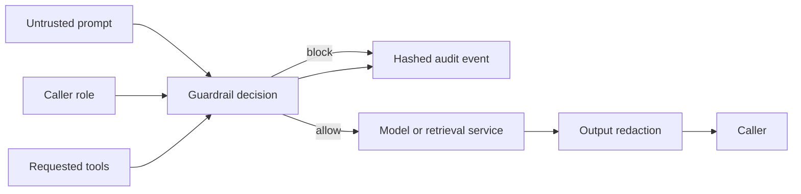

# AI Security Guardrails Lab

A model-independent security layer for LLM-backed services. It evaluates untrusted prompts, authorizes requested tools by caller role, redacts sensitive output, and records privacy-preserving audit events before an application calls a model provider or action tool.

The project runs locally with Python's standard library and does not require model credentials or a cloud subscription.

## Controls included

- Configurable prompt-injection, prompt-extraction, data-exfiltration, and command-execution rules.
- Explicit role-to-tool authorization with a global denylist for high-risk tools.
- Unicode normalization to catch simple fullwidth-character bypass attempts.
- Output redaction for access-key shapes, bearer tokens, and email addresses.
- JSONL audit records containing hashes and decision metadata instead of raw prompts.
- Twelve adversarial evaluation cases with a deterministic Markdown report.
- Unit tests and live HTTP API tests in GitHub Actions.

## Architecture



## Quick start

Requires Python 3.11 or later.

```bash
python3 -m venv .venv
source .venv/bin/activate
python -m pip install -e .
python -m unittest discover -s tests -v
python -m ai_security_guardrails evaluate --fail-on-mismatch
```

Start the local API:

```bash
python -m ai_security_guardrails serve --host 127.0.0.1 --port 8080
```

Evaluate a request:

```bash
curl --request POST http://127.0.0.1:8080/v1/evaluate \
  --header 'Content-Type: application/json' \
  --header 'X-Trace-ID: demo-trace-001' \
  --data '{
    "prompt": "Create a ticket for the failed image scan.",
    "role": "operator",
    "requested_tools": ["create_ticket"],
    "session_id": "local-demo"
  }'
```

Redact model output:

```bash
curl --request POST http://127.0.0.1:8080/v1/redact \
  --header 'Content-Type: application/json' \
  --data '{"text":"Contact security@example.com with Bearer abcdefghijklmnop"}'
```

## Repository layout

```text
config/policy.toml                 configurable limits, roles, and rules
evals/adversarial-cases.jsonl      allowed and blocked evaluation cases
reports/evaluation-report.md       deterministic evaluation result
src/ai_security_guardrails/        policy engine, API, audit, and CLI
tests/                             policy, audit, dataset, and HTTP tests
docs/                              threat model, Azure pattern, and response guide
```

## Security boundaries

This is a deterministic enforcement layer, not a claim that regular expressions solve prompt injection. Keep high-impact approval outside the model, isolate retrieval data, use short-lived workload identity, restrict tool permissions, and continuously add domain-specific attack cases.

See [the threat model](docs/threat-model.md), [Azure AI Foundry integration pattern](docs/azure-ai-foundry.md), and [unsafe AI response playbook](docs/incident-response.md).
